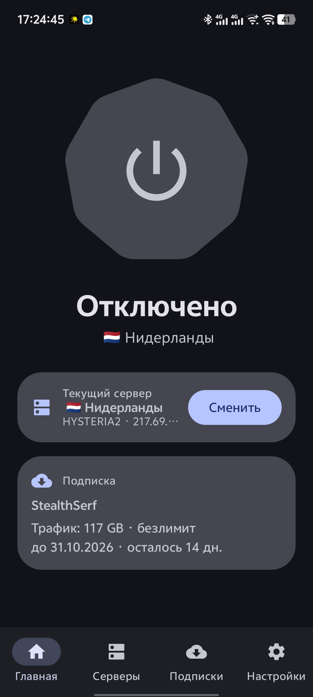

# ZenesVPN

<p align="center">
  
</p>

**ZenesVPN** — Android-клиент VPN в стиле Google Material на ядре
[sing-box](https://github.com/SagerNet/sing-box) (libbox 1.14.3). Работает с
вашими собственными конфигами — никаких встроенных серверов и аккаунтов.


## Возможности

- **Протоколы**: VLESS (Reality), VMess, Trojan, Shadowsocks, Hysteria2, TUIC
- **Импорт**: из буфера обмена, QR-кода или ссылки на подписку
- **Подписки**: автоматический разбор `subscription-userinfo` (трафик/срок) и
  `profile-title` (название) — волнистый прогресс-бар расхода трафика и
  обратный отсчёт до конца подписки прямо в карточке
- **Серверы**: список с TCP-пингом, выбор активного сервера в один тап
- **Самообновление**: проверка и скачивание обновлений из GitHub Releases
  прямо из приложения — работает и при включённом VPN (трафик апдейтера
  идёт в обход туннеля), установка через системный установщик
- **Статистика**: скорость и объём трафика в реальном времени
- **Плитка в шторке**: включение/выключение VPN из Quick Settings одним
  нажатием, работает даже при убитом процессе приложения
- **Маршрутизация по приложениям**: режимы «Все», «Только выбранные», «Кроме
  выбранных» (удобно для банковских приложений)
- **Kill Switch**: открытие системного экрана Always-on VPN с блокировкой
  трафика без VPN
- **Автозапуск**: подключение после загрузки устройства
- **Дизайн**: Material 3 Expressive — крупная кнопка-«печенька» с пружинным
  откликом, expressive-анимации, динамические цвета Android 12+
- **Языки**: русский и английский

## Установка

1. Скачайте `ZenesVPN-<версия>-arm64.apk` со страницы
   [Releases](https://github.com/ZenesDK/ZenesVPN/releases).
2. Откройте APK и разрешите установку из этого источника.
3. Импортируйте конфиг: вкладка «Серверы» → добавить (клипборд / QR / подписка).
4. Выберите сервер и нажмите большую кнопку.

> Приложение не содержит встроенных серверов — конфиги должны быть у вас
> (например, от вашего провайдера VPN).

### Плитка в шторке

Откройте шторку → «Изменить» (карандаш) → перетащите плитку **ZenesVPN** на
активную панель. Далее — одно нажатие: VPN подключается к выбранному серверу
без открытия приложения. Если системе нужно согласие на VPN, плитка сама
откроет приложение для подтверждения (один раз).

## Сборка из исходников

```bash
./gradlew :app:assembleRelease
```

Требования: JDK 17, Android SDK (compileSdk 36).

Подпись релиза: движок читает `keystore.properties` в корне проекта (или
переменные окружения `STOREFILE`, `STOREPASSWORD`, `KEYALIAS`, `KEYPASSWORD`).
Файл и сам keystore **не хранятся в репозитории**:

```properties
storeFile=keystore/zenes.jks
storePassword=...
keyAlias=...
keyPassword=...
```

Без файла сборка `release` проходит, но APK остаётся неподписанным.

### Сборка релиза через GitHub Actions

При пуше тега `v*` workflow [`.github/workflows/release.yml`](.github/workflows/release.yml)
собирает APK и публикует GitHub Release с артефактом. Чтобы релиз был
подписан тем же ключом, добавьте в *Settings → Secrets and variables → Actions*
репозитория:

| Секрет | Значение |
|---|---|
| `KEYSTORE_B64` | `base64 -w0 app/keystore/zenes.jks` |
| `STOREPASSWORD` | пароль keystore |
| `KEYALIAS` | alias ключа |
| `KEYPASSWORD` | пароль ключа |

Без секретов workflow публикует неподписанный APK (для теста сборки).

## Структура

```
app/src/main/java/com/zenes/vpn/
├── bg/        # VPN-сервис, плитка шторки, шина состояния, boot-ресивер
├── core/      # Генерация конфига sing-box
├── data/      # Хранилище (SharedPreferences + JSON)
├── parser/    # Разбор ссылок vless:// vmess:// ss:// hysteria2:// tuic://
├── ui/        # Compose-интерфейс (Material 3 Expressive)
└── util/      # Импорт подписок, пинг
```

## Лицензия

[MIT](LICENSE) © Zenes
