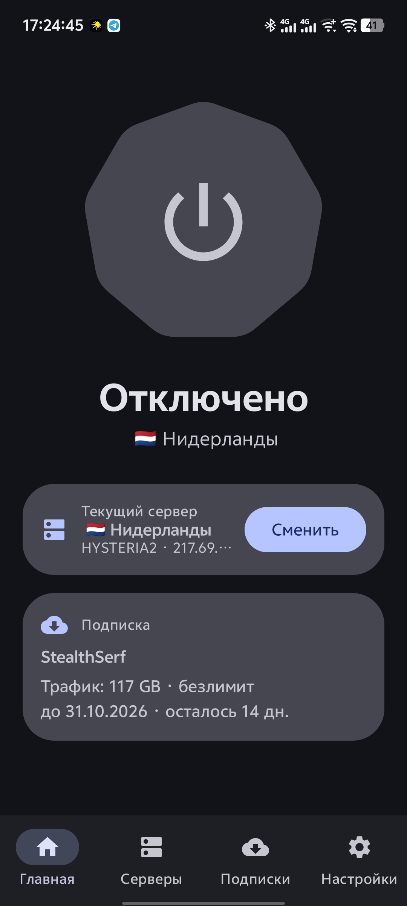

# ZenesVPN

  
  <!-- Кадры для галереи: положите файлы в docs/ и раскомментируйте нужные строки.
  
  
  
  -->
  <!-- GIF-демонстрация: положите docs/demo.gif и раскомментируйте.
  
  -->

**ZenesVPN** — Android-клиент VPN в стиле Google Material на ядре
[sing-box](https://github.com/SagerNet/sing-box) (libbox 1.14.3). Работает с
вашими собственными конфигами — никаких встроенных серверов и аккаунтов.

**[Скачать последнюю версию](https://github.com/ZenesDK/ZenesVPN/releases/latest)** ·
[все релизы](https://github.com/ZenesDK/ZenesVPN/releases) ·
[теги](https://github.com/ZenesDK/ZenesVPN/tags)

## Возможности

- **Протоколы**: VLESS (Reality), VMess, Trojan, Shadowsocks, Hysteria2, TUIC
- **Импорт**: из буфера обмена, QR-кода или ссылки на подписку
- **Подписки**: автоматический разбор `subscription-userinfo` (трафик/срок) и
  `profile-title` (название) — волнистый прогресс-бар расхода трафика и
  обратный отсчёт до конца подписки прямо в карточке
- **Серверы**: список с TCP-пингом, выбор активного сервера в один тап
- **Самообновление**: проверка и скачивание обновлений из GitHub Releases
  прямо из приложения — работает и при включённом VPN (запросы апдейтера идут
  через туннель, а когда он опущен — напрямую), установка через системный
  установщик
- **Канал обновлений**: переключатель «Все новые» / «Только стабильные» —
  пререлизы видны только в первом режиме
- **Статистика**: скорость и объём трафика в реальном времени + экран
  статистики (дневные бары за 7/14/30 дней, разбивка по серверам, хранение
  90 дней на устройстве)
- **Блокировка рекламы**: на уровне DNS по правилу `geosite-category-ads-all`
  (rule-set встроен в APK; опция в настройках, применяется при следующем
  подключении)
- **Плитка в шторке**: включение/выключение VPN из Quick Settings одним
  нажатием, работает даже при убитом процессе приложения
- **Маршрутизация по приложениям**: режимы «Все», «Только выбранные», «Кроме
  выбранных» (удобно для банковских приложений); выбранные приложения
  поднимаются наверх списка
- **Kill Switch**: открытие системного экрана Always-on VPN с блокировкой
  трафика без VPN
- **Автозапуск**: подключение после загрузки устройства
- **Диагностика**: журнал с логами движка; карточка оптимизации батареи в
  настройках (детект ограничений + системный диалог исключения)
- **Дизайн**: Material 3 Expressive — крупная кнопка-«печенька» с пружинным
  откликом, expressive-анимации, монотонная лавандовая тон-система (светлая
  и тёмная темы)
- **Языки**: русский и английский

## Архитектура

Коротко о том, как это устроено внутри — для тех, кто читает код.

### Туннель

- **Ядро** — [sing-box](https://github.com/SagerNet/sing-box): в APK входит
  собранный AAR `libbox` (v1.14.3), приложение управляет движком через его
  командный API (старт/стоп, поток статуса, поток логов).
- **Платформенный слой** — реализация `PlatformInterface` libbox под Android.
  `getInterfaces()` перечисляет сети через `ConnectivityManager`: кросс-сверка
  с Java-интерфейсами, флаги `IFF_UP|RUNNING`, тип wifi/cellular/ethernet по
  `NET_CAPABILITY`, DNS и шлюзы из `LinkProperties`. Паттерн перенесён из
  открытого клиента sing-box for Android (SFA): без него движок на прошивках
  вроде OriginOS «видит» фантомные интерфейсы и не может привязать исходящие.
- **Монитор default-interface** — семантика потерь как в SFA: при потере сети
  движку уходит пустой отчёт (`("", -1)`), отчёты дедуплицируются, ничего не
  отправляется, пока данные не готовы. Движок доверяет только платформенным
  отчётам и привязывает исходящие соединения к актуальному интерфейсу.
- **Watchdog** — автореконнект (до 5 попыток с backoff) при падении движка,
  неудачном старте или зависании в CONNECTING; стабильная сессия сбрасывает
  счётчик; восстановление после убийства процесса через `START_STICKY`.
  Отдельно — самолечение «зелёного мёртвого туннеля»: туннель выглядит
  подключённым, но трафик не идёт → вердикт «недоступен», 30 секунд
  наблюдения, затем один контролируемый рестарт движка в рамках бюджета.

### Как апдейтер обходит VPN

Вспомогательные запросы (проверка обновлений, скачивание APK, обновление
подписок, пинги серверов) выбирают сетевой путь осознанно:

- пока туннель поднят — запросы идут **через туннель**: на сетях, где прямой
  доступ к GitHub заблокирован или ограничен оператором, обновления и
  подписки всё равно работают;
- когда VPN выключен — единственная **прямая** попытка;
- сразу после подключения выполняется один принудительный ретрай через
  туннель — на случай запросов, ушедших до поднятия туннеля;
- проблемы с сетью честно всплывают в интерфейсе (подсказки о заблокированной
  сети вместо молчаливых таймаутов).

## Установка

1. Скачайте `ZenesVPN-<версия>-arm64.apk` со страницы
   [Releases](https://github.com/ZenesDK/ZenesVPN/releases).
2. Откройте APK и разрешите установку из этого источника.
3. Импортируйте конфиг: вкладка «Серверы» → добавить (клипборд / QR / подписка).
4. Выберите сервер и нажмите большую кнопку.

> Приложение не содержит встроенных серверов — конфиги должны быть у вас
> (например, от вашего провайдера VPN).

### Плитка в шторке

Откройте шторку → «Изменить» (карандаш) → перетащите плитку **ZenesVPN** на
активную панель. Далее — одно нажатие: VPN подключается к выбранному серверу
без открытия приложения. Если системе нужно согласие на VPN, плитка сама
откроет приложение для подтверждения (один раз).

## Сборка из исходников

    ./gradlew :app:assembleRelease

Требования: JDK 17, Android SDK (compileSdk 36).
Подпись релиза: движок читает `keystore.properties` в корне проекта (или
переменные окружения `STOREFILE`, `STOREPASSWORD`, `KEYALIAS`, `KEYPASSWORD`).
Файл и сам keystore **не хранятся в репозитории**:

    storeFile=keystore/zenes.jks
    storePassword=...
    keyAlias=...
    keyPassword=...

Без файла сборка `release` проходит, но APK остаётся неподписанным.

### Сборка релиза через GitHub Actions

При пуше тега `v*` workflow [`.github/workflows/release.yml`](.github/workflows/release.yml)
собирает APK и публикует GitHub Release с артефактом. Чтобы релиз был
подписан тем же ключом, добавьте в *Settings → Secrets and variables → Actions*
репозитория:

| Секрет | Значение |
|---|---|
| `KEYSTORE_B64` | `base64 -w0 app/keystore/zenes.jks` |
| `STOREPASSWORD` | пароль keystore |
| `KEYALIAS` | alias ключа |
| `KEYPASSWORD` | пароль ключа |

Без секретов workflow публикует неподписанный APK (для теста сборки).

## Структура

    app/src/main/java/com/zenes/vpn/
    ├── bg/        # VPN-сервис, плитка шторки, шина состояния, boot-ресивер
    ├── core/      # Генерация конфига sing-box, апдейтер
    ├── data/      # Хранилище (SharedPreferences + JSON)
    ├── parser/    # Разбор ссылок vless:// vmess:// ss:// hysteria2:// tuic://
    ├── ui/        # Compose-интерфейс (Material 3 Expressive)
    └── util/      # Импорт подписок, пинг

## Атрибуция

Честное разделение «своего» и «чужого».

**Взято из open source:**

- [sing-box](https://github.com/SagerNet/sing-box) (SagerNet / nekohasekai) —
  сетевое ядро; в APK входит скомпилированный `libbox` v1.14.3, лицензия
  движка — **GPL-3.0+**, исходники — в репозитории sing-box;
- паттерны платформенной интеграции (`PlatformInterface`, монитор
  default-interface, семантика отчётов о потере сети) сверены с открытым
  клиентом sing-box for Android (SFA) и примерами libbox — спасибо SagerNet;
- `geosite-category-ads-all.srs` (база блокировки рекламы) — из публичного
  набора rule-sets sing-box, данные проекта
  [v2fly/domain-list-community](https://github.com/v2fly/domain-list-community).

**Своё:**

- интерфейс на Jetpack Compose в духе Material 3 Expressive, включая
  монотонную лавандовую тон-систему (v1.14.4);
- парсер ссылок `vless:// vmess:// ss:// hysteria2:// tuic://` и разбор
  подписок (`subscription-userinfo`, `profile-title`);
- апдейтер с выбором канала обновлений и выбором сетевого пути (туннель/прямой);
- watchdog автопереподключения и самолечение мёртвого туннеля;
- UX per-app маршрутизации, локальная статистика (90 дней на устройстве);
- релизный пайплайн: GitHub Actions → подписанный APK в Releases.

## Лицензия

Код приложения — [MIT](LICENSE) © Zenes.

В состав APK входит скомпилированное ядро
[sing-box](https://github.com/SagerNet/sing-box) (libbox), распространяемое
по лицензии **GNU GPL-3.0+**; его исходники — в репозитории SagerNet.
